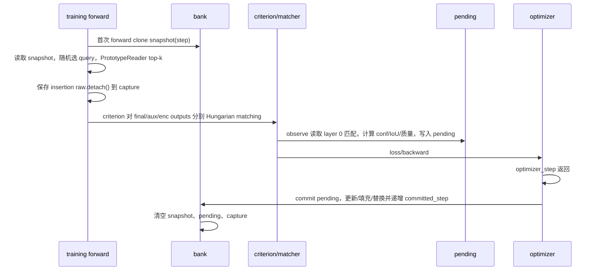

# OCPM 写入、更新、读取、淘汰与时序审计

- 审计对象：`MARN-DETR-personal` 当前工作树
- 分支：`codex/ocpm-quality-v2`
- 基线 HEAD：`6019a8ad7a066554b4e8fc999de7dc82021cf887`
- 审计性质：只读审计；本轮未修改任何 Python 源码
- 工作树说明：审计开始时已有上一轮未提交的 OCPM 质量分改动，以下“当前实现”包含这些未提交改动；历史 HEAD 行为在差异处单独说明。

## 结论摘要

1. **当前匹配不是最终层匹配。** `SetCriterion.forward()` 为最终输出、辅助输出和 encoder 输出分别生成 `all_indices`；`MARNConfig.layer=0` 使 `MARNAdapter.observe()` 选择 `suffix="_0"`，即第一个辅助 decoder 输出的 Hungarian 匹配。最终输出对应空后缀 `""`，当前没有被 OCPM 写入筛选使用。
2. **原型特征来自插入层的 `raw`。** Transformer 在 `layer_id == marn.config.layer` 的 decoder 层完成后调用 MARN；`MARNAdapter.forward()` 保存 `raw.detach()`，当前配置下它是 layer 0 输出、记忆修正前的特征。`observe()` 再按 layer 0 匹配的源 query 索引提取该特征。
3. **当前质量字段已经拆分，但 `quality_eta` 默认是 `None`。** `quality_diag` 保留旧的 `sqrt(conf*IoU)` 诊断；`write_quality` 只有在稳定性、新颖性、分散度和 eta 都可用时才是有限值。默认配置下多数候选的 `Q_write` 为未知，重复候选和淘汰会回退到 `quality_diag`。
4. **检索不再直接使用 Q_write。** 当前检索使用余弦相似度、类别兼容、几何兼容和年龄；旧的 `quality_weight` 配置字段仍存在用于兼容元数据，但评分表达式已忽略它。
5. **训练读取使用旧 bank 快照，当前样本不会读取本次刚写入的 pending 候选。** 快照在一个 optimizer window 首次 forward 时 clone；`observe()` 仅放入 `pending`；`commit()` 在 optimizer step 返回后执行。梯度累积窗口内也复用同一快照。
6. **验证和测试不写入 bank。** `observe()` 要求 `self.training`；eval forward 只创建快照，不创建 capture/pending，也不会调用 commit。
7. **UAMR 配对收益标签不在当前核心 OCPM 代码中。** 仓库的实验目录包含离线/在线 UAMR 原型和配对干预脚本，但它们不是 `rf-detr/src/rfdetr/marn` 的核心路径，不能视为当前 OCPM 已内置的收益标签生成器。

## 决策审计

### 1. 候选写入

候选由 `MARNAdapter.observe()` 产生。它使用 `all_indices[index]` 的匹配结果，其中 `index` 对应 `suffixes.index("_0")`。对每个匹配对读取：

- `labels[dst]`：目标类别；
- `layer_outputs["pred_logits"][b, src, labels]` 的 sigmoid：类别 conf；
- `layer_outputs["pred_boxes"][b, src]`：预测几何框；
- `target["boxes"][dst]`：GT 框，仅用于训练期 IoU 和写入门控；
- `raw[b, src]`：layer 0 插入层特征；
- `target["marn_object_id"][dst]` 与 `image_id`：批内去重键。

现有硬门控仍是有限值、正框宽高、`conf >= confidence_min`、`IoU >= iou_min`。`quality_diag` 是 `sqrt(conf * IoU)`。新的 `Q_write` 由 `R/V` 计算，但默认 eta 未配置时是未知值。

### 2. 原型更新

`commit()` 按类别寻找槽位。若已有同类槽位与候选特征余弦相似度达到 `similarity_update`，执行特征、几何和质量元数据的 EMA 更新；否则优先填充空槽位。更新在 optimizer step 完成后发生。

- 特征和几何：由 `feature_ema` 控制 EMA；
- `quality_diag`：独立 EMA；
- `write_quality`：有限时 EMA；旧槽位未知而新候选有限时直接建立有限值；
- `updated_step`：提交步更新；
- `source_image/source_object`：记录最新来源。

### 3. 当前查询读取

训练和推理的初始路由仍是确定性伪随机选择固定数量 query；它不是基于质量分的路由。被选 query 进入 `PrototypeReader`。

`PrototypeReader` 对整个 bank 计算：

- query/prototype key 的 cosine；
- 类别兼容分；
- 宽高几何兼容分；
- 年龄惩罚；
- `min_cosine` 过滤和 top-k 混合。

当前检索评分不读取 `quality_diag` 或 `write_quality`。读取结果的 summary 第二维现在记录加权几何兼容，而不是旧质量值。`quality_weight` 仍是 `RetrievalConfig` 字段，但仅为旧配置兼容保留，已不进入评分。

### 4. bank 满时淘汰

同类别槽位全部占用且候选未触发相似更新时进入替换。当前替换排序是可解释的字典序：

1. 先处理 `write_quality` 未知的槽位；
2. 再处理较低的有限 `write_quality`；
3. 再以较高冗余度优先；
4. 再以较老槽位优先；
5. 最后以槽位索引稳定打破平局。

未知 `write_quality` 的槽位使用 `quality_diag` 作为维护回退。因此淘汰仍可能间接依赖旧诊断分，但不影响检索评分。

### 5. 时序与泄漏

训练时序如下：

因此：

- 当前样本在同一 optimizer window 内读取的是旧 snapshot；
- 当前样本写入的 pending 不会在本窗口被 reader 看到；
- 同一 batch 内候选不会立即相互影响读取；
- bank 只在 commit 后对后续 window 可见；
- 该结论依赖 `optimizer_step()` 必须正常返回并调用 `adapter.commit()`。

## 字段映射表

| 字段/信号 | 产生位置 | 当前含义 | 使用阶段/决策 | GT 或未来信息 | 当前风险/状态 |
|---|---|---|---|---|---|
| `all_indices` | `SetCriterion.forward()` / matcher | 各输出层独立 Hungarian 匹配 | 写入候选筛选、损失 | 训练匹配使用 GT；验证也可计算但 observer 不运行 | 当前 OCPM 取 `_0` 辅助匹配，不是最终层；需核实是否要切换 |
| `suffixes` | `SetCriterion.forward()` | `""` final、`"_0"...` aux、`"_enc"` encoder | 选择 OCPM 匹配层 | 无额外未来信息 | `MARNConfig.layer=0` 固定为 aux 0 |
| `raw` / `capture` | `MARNAdapter.forward()` | 插入层 query 特征，当前为 layer 0 输出且未做 MARN 修正 | 原型内容 | 无 GT；训练时 detach | 特征层与匹配层一致为 aux 0 的 query 索引，但 final 预测未参与筛选 |
| `labels` | `target["labels"]` | 原始 COCO 类别 ID | 候选类别、类别槽位选择 | 训练 GT | 仅训练数据开启 object ID；类映射协议需保持一致 |
| `pred_logits` | `layer_outputs` | 匹配 query 的分类 logits | `conf`、旧诊断分 | 训练预测；索引由 GT 匹配给出 | sigmoid 单类 logit 定义需实验校准；不是校准概率 |
| `conf` | `pred_logits[..., labels].sigmoid()` | 匹配 GT 类别的分类置信度 | 写入硬门控、`R`、`quality_diag` | 训练阶段依赖 GT 类别 | 高 conf 不等于高原型代表性或任务收益 |
| `pred_boxes` | `layer_outputs` | 匹配 query 的归一化预测框 | 几何元数据、IoU | 训练预测 | 当前来自 aux 0 输出，不是 final 输出 |
| `target["boxes"]` | COCO training target | 匹配目标 GT 框 | `paired_iou`、写入硬门控、`R` | 依赖训练 GT；不可用于验证/测试在线写入 | 只允许训练 observer 使用 |
| `IoU` | `paired_iou(pred_boxes, target_boxes)` | 预测框与 GT 框 IoU | 写入硬门控、`R`、`quality_diag` | 依赖 GT | IoU 本身不是任务收益，也不是特征纯度 |
| `quality_diag` | `sqrt(conf*IoU)` | 旧式可解释诊断量 | 重复候选回退、淘汰回退、诊断 | 训练 GT 间接参与 | 不是 Q_write；回退使用会让未知质量槽位仍受旧分影响 |
| `R` | `compute_write_quality()` | 分类/定位联合可靠性 | Q_write 组成 | 训练 GT 间接参与 | 只是可靠性，不代表检索相关性或干预收益 |
| `S` | `observe()` 同一 `(image_id, object_id)` 的重复记录 | 当前观测窗口内的特征稳定性 | Q_write 组成 | 无额外 GT，但依赖重复组/重复观测 | 单例为 NaN；重复来源和统计代表性待实验核实 |
| `N` | `_novelty_and_coverage()` | 候选与同类 bank 原型最大相似度的反量 | Q_write 组成、重复候选排序间接使用 | 只读旧 snapshot | 未验证的表征新颖性代理，不等于稀有变化覆盖价值 |
| `D_c` | `_novelty_and_coverage()` | 同类已有槽位两两分散度代理 | Q_write 组成 | 只读旧 snapshot | 空类/单槽显式设为 1，是设计回退，不是测量结论 |
| `V` | `sqrt(N*D_c)` | 新颖性/覆盖组合项 | Q_write 组成 | 只读旧 snapshot | 公式尚未实验校准 |
| `write_quality` | `compute_write_quality()` / bank buffer | Q_write；默认 eta=None 时未知 | 写入排序、更新元数据、淘汰 | 训练阶段候选信号 | 当前默认未启用有限值；需冻结 eta 和 S 方案 |
| `quality_eta` | `MARNConfig` | Q_write 保底系数 | Q_write 计算 | 配置，不是标签 | 当前为 None，未校准 |
| `similarity_update` | `MARNConfig` / `commit()` | 同类槽位 EMA 更新判据 | 更新 | 无 GT | 与 Q_write 分离；阈值仍是旧配置 |
| `feature_ema` | `MARNConfig` / `commit()` | 特征/几何/质量 EMA 动量 | 更新 | 无 GT | 影响时效性和稳定性，未单独校准 |
| `updated_step` | `commit()` / bank buffer | 最后一次更新的训练步 | 年龄、淘汰并列因素、检索年龄惩罚 | 不依赖 GT | 是训练步年龄，不是数据时间或模型版本 |
| `valid` | bank buffer | 槽位是否已填充 | 检索资格、空槽判断 | 不依赖 GT | 不能表示原型质量，只表示槽位状态 |
| `source_image/source_object` | `commit()` | 最新来源追踪 | 诊断/追溯 | 训练 GT object ID | 不进入 reader；checkpoint 生命周期需核实 |
| `selected` | `MARNAdapter.forward()` | 固定数量伪随机 query 选择 | 当前读取路由 | 无 GT、无未来信息 | 不是 UAMR；随机基线 |
| `accepted` | `PrototypeReader.forward()` | 是否存在合格检索候选 | 读取后 MGQR 是否执行 | 无 GT | 只表示检索候选可用，不表示干预有益 |
| UAMR 配对收益标签 | 核心 `src` 未发现生成器；实验目录有 C5/C6 脚本 | 记忆干预前后损失差的实验性标签 | 路由训练/诊断 | 训练期配对干预可用；推理不可用 | 当前不是 OCPM 核心内置字段；需查实际运行入口 |

## quality 的跨决策复用审计

| 决策 | `quality_diag` | `write_quality` | 检索相似度/兼容性 |
|---|---|---|---|
| 写入候选筛选 | 保留为诊断，旧硬门控仍由 conf/IoU 完成 | 计算并记录；默认可能未知 | 不用于硬门控 |
| 同对象重复候选保留 | Q_write 有限时优先；未知时回退 quality_diag | 直接排序 | 不用于重复去重 |
| 相似原型更新 | 不决定是否更新 | 更新后 EMA 保存 | 更新判据是特征 cosine 与 `similarity_update` |
| bank 满替换 | Q_write 未知时回退 quality_diag | 主要维护排序 | 冗余、年龄打破平局 |
| 查询检索 | 不使用 | 不使用 | 直接使用 cosine、类别、几何、年龄 |
| UAMR | 不使用 | 不使用 | UAMR 目标应是配对干预收益，不是相似度 |

## checkpoint 与元数据

- `PrototypeBank` 的 bank buffers 会随模块 state dict 保存，包括新 `quality_diag`、`write_quality` 以及旧兼容 `quality`。
- `_load_from_state_dict()` 对旧 checkpoint：
  - 从旧 `quality` 迁移 `quality_diag`；
  - 缺少 `write_quality` 时填充 NaN，表示未知；
  - 保留旧 `quality` 兼容键。
- `MARNTrainingModule` 的 lifecycle checkpoint 描述包含 `marn_config`、class IDs、reader/refiner 配置，并对旧配置缺少 `quality_eta` 做兼容处理。
- `MARNModelModule` 的基础 checkpoint hook 仍使用严格的 `marn_config` 字典比较；是否所有实际训练/恢复入口都走 `MARNTrainingModule`，需要查启动脚本和 checkpoint 恢复路径。
- 目前没有证据表明 `source_image/source_object` 在独立推理导出中被清除；它们属于 bank buffer，应核实导出体积与隐私/追溯要求。

## 验证/测试写入结论

- `MARNAdapter.observe()` 首行要求 `self.training`，因此 eval/validation forward 不进入候选写入。
- `MARNAdapter.forward()` 的 eval 分支只做 `bank.snapshot(step)`，并在存在 pending/snapshot 时拒绝非边界评估。
- `optimizer_step()` 是唯一核心 commit 调用点；如果训练异常发生在 optimizer 返回前，pending 不会提交，属于安全丢弃而非验证写入。
- `MARNDataModule` 只在训练数据集启用 `marn_keep_object_ids`；验证数据集沿用官方路径，不附加 MARN object IDs。

## 当前代码事实、设计目标与未证实假设

### 已确认的代码事实

- OCPM 观察的是 `_0` auxiliary Hungarian assignment。
- 原型 raw 特征来自 MARN 插入层 layer 0。
- 训练读取使用 clone 的旧 bank snapshot，commit 在 optimizer step 后。
- eval/validation 不调用 observer，不写入 bank。
- reader 当前采用随机 query 选择，再在 bank 内做相似度/类别/几何/年龄 top-k 检索。
- UAMR 配对收益标签不在核心 OCPM 源码路径中。

### 设计目标或实现建议，不是现状

- “最终层 Hungarian 匹配筛选、layer=0 特征入库”尚未在当前代码接线；当前代码仍使用 `_0` 匹配。
- `Q_write` 的完整有限值策略需要显式配置 eta 和稳定性来源；当前默认配置并未校准。
- UAMR 的收益预测需要与 OCPM 质量字段保持独立。

### 待验证假设

- layer 0 auxiliary 匹配是否比最终层匹配更适合作为写入筛选。
- 单窗口重复组 cosine 是否能代表特征稳定性。
- `N` 和 `D_c` 是否真的提高稀有变化覆盖，而不是偏向离群噪声。
- Q_write 排序是否优于旧 quality_diag 回退。
- 检索不使用 Q_write 后是否改变原型读取分布和最终检测收益。
- 当前 UAMR 实验目录中的收益标签是否与当前核心分支接口、bank 时序和模型版本一致。

## 待查代码字段和数据流清单

1. 实际训练入口到底实例化 `MARNModelModule` 还是 `MARNTrainingModule`；这决定 checkpoint 迁移 hook 是否生效。
2. `SetCriterion` 的 `matched_outputs` 顺序是否在所有配置中保持 final、aux、enc 的约定；尤其是 `aux_outputs` 为空或 decoder 层数变化时，`_0` 的语义需锁定。
3. `layer_outputs["pred_logits"]` 与 `pred_boxes` 是否始终由同一层 hidden state 和同一组 head 生成；当前 writer 假设二者与 `raw` 的源 query 索引一致。
4. 训练组重复样本是否保证相同 `(image_id, marn_object_id)` 真正代表同一对象，而不是仅仅复制 targets；这会影响 `S` 的有效性。
5. `quality_eta` 的配置来源、checkpoint 恢复和实验记录格式；当前 None 代表未校准。
6. `source_image/source_object` 是否应进入正式导出 artifact；如不需要，应在导出前清理或单独标记。
7. 实验目录 C5/C6 的 UAMR 配对收益标签生成是否仍可复现，并且是否使用当前 OCPM reader、当前插入层和同一固定匹配协议。
8. 旧 checkpoint 的 bank buffer 是否真的包含旧 `quality`；若旧 artifact 只保存模型参数而不保存 bank，需要单独恢复策略。
9. 当前 `quality_weight` 字段虽然不参与检索，是否有外部脚本仍读取它并将其误解为有效检索权重。
10. 当前 `updated_step` 是否需要与模型权重版本、投影版本和数据域版本分开记录；单独的训练步年龄不能识别所有漂移。

## 审计输出边界

本报告只记录代码事实、字段流向和待查事项，不把现有单 seed/短实验结果写成稳定 AP 结论，也不把 conf、相似度或 quality_diag 解释为记忆干预收益。
