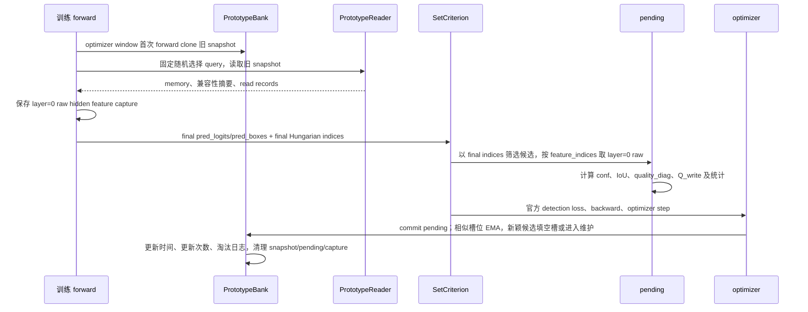

# OCPM 原型记忆库改进最终报告

## 推荐结论

当前代码已经形成一条可审计的 OCPM 改进路径：用最终 decoder 层 Hungarian 匹配筛选写入候选，用 layer=0 raw hidden feature 保存原型；将 `quality_diag` 与 `Q_write` 分开；训练读取使用 optimizer window 开始时的旧 bank snapshot，optimizer step 后才提交写入；检索仍保持固定随机 query 路由，并且不直接使用 `Q_write`。

建议把这版作为“字段与时序审计基线”，暂不宣称它带来 AP 改善。当前环境无法运行 PyTorch，防泄漏动态用例没有执行，版本漂移检查失败，A–H 对照实验也没有在当前分支完成。因此，当前证据不足以支持稳定 AP 改善结论。下一步应先补齐可运行环境和漂移元数据，再按固定初始 checkpoint、多 seed 的矩阵重新实验。

这里必须保持三条边界：

1. 原型可靠性不等于检索相关性。`conf`、`IoU` 和 `Q_write` 主要描述候选是否值得写入或维护，不能说明它一定适合某个查询。
2. 检索相似度不等于任务收益。cosine、类别兼容和几何兼容只描述匹配程度，不能证明记忆修正会改善检测。
3. UAMR 收益预测不能由原型质量分替代。UAMR 的监督必须来自同一输入、同一模型状态和同一 bank snapshot 下的配对干预收益。

## 1. 分支、提交和工作树

| 项目 | 当前值 |
|---|---|
| Git 根目录 | `D:\HuaweiMoveData\Users\33182\Desktop\论文\MARN-DETR-personal` |
| 分支 | `codex/ocpm-quality-v2` |
| HEAD | `6019a8ad7a066554b4e8fc999de7dc82021cf887` |
| HEAD 提交 | `Record verified GitHub Release asset hashes and download mapping` |
| 工作树 | 不干净；存在未提交源码、测试和审计文件 |
| 与远端状态 | 分支跟踪 `origin/main`；本报告不执行提交或合并 |

本报告以当前工作树为准，不把 HEAD 中的旧实现误当成最终实现。此前的 `audit_reports/ocpm_audit_report.md` 是修改前审计，仍描述 `_0` auxiliary matching；该描述已被本报告中的当前源码事实覆盖。

## 2. 修改文件清单

### 源码

- `rf-detr/src/rfdetr/marn/__init__.py`：导出 UAMR 配对标签接口。
- `rf-detr/src/rfdetr/marn/core.py`：扩展 bank 字段、旧 checkpoint 迁移、snapshot 和检索审计记录；保持随机读取协议并移除 `Q_write` 对检索评分的直接作用。
- `rf-detr/src/rfdetr/marn/integration.py`：实现最终匹配接线、layer=0 特征捕获、候选质量统计、`Q_write` 计算、EMA 更新、固定容量维护和 commit 时序。
- `rf-detr/src/rfdetr/marn/lifecycle.py`：保证 bank commit 与 optimizer/EMA 边界一致。
- `rf-detr/src/rfdetr/models/criterion.py`：一次传递最终层匹配和 layer=0 特征索引，官方检测损失未改动。
- `rf-detr/src/rfdetr/marn/uamr.py`：新增训练期、固定匹配、配对干预收益标签和统计接口；尚未接入在线 UAMR 路由。

### 测试和报告

- `rf-detr/tests/marn/test_ocpm_leakage.py`
- `rf-detr/tests/marn/test_ocpm_leakage_static.py`
- `audit_reports/ocpm_field_mapping.csv`
- `audit_reports/ocpm_audit_report.md`（修改前审计，保留作历史记录）
- `audit_reports/ocpm_leakage_test_report.md`
- `audit_reports/ocpm_min_comparison_report.md`
- `audit_reports/ocpm_min_comparison.csv`
- `audit_reports/uamr_paired_intervention_audit.md`
- `audit_reports/ocpm_final_improvement_report.md`（本报告）

## 3. 原有数据流

原有审计记录对应的流程是：`SetCriterion.forward()` 对 final、auxiliary 和 encoder 输出分别做 Hungarian matching；OCPM 根据 `MARNConfig.layer=0` 选择 `suffix="_0"` 的第一个 auxiliary 匹配。MARN 在插入层保存 raw 特征，再用该 auxiliary 匹配的 query 索引读取特征、计算类别置信度和 GT IoU，经过有限值、置信度和 IoU 门控后进入 pending 或 bank。查询端先固定伪随机选择 query，再使用 bank 内的检索和 top-k 混合；旧实现的质量字段在不同维护路径中存在回退复用。

旧流程的主要问题是匹配层与最终检测输出不一致，且单个旧 `quality` 字段容易被误读成通用质量指标。该流程描述仅用于说明改动前基线，不代表当前实现。

## 4. 新数据流



当前关键时序是：读取发生在旧 snapshot 上；候选先进入 pending；只有 optimizer step 返回后才 commit。因而当前样本不能读到自己刚产生的候选，同一 optimizer window 的 microbatch 共享同一 bank 快照，同一 batch 内候选写入顺序不应改变读取结果。评估路径只创建 snapshot，不调用 `observe()` 或 `commit()`。

## 5. 字段定义和当前实现状态

| 字段 | 当前含义 | 产生/保存位置 | 决策边界 | 状态和限制 |
|---|---|---|---|---|
| `features` | 原型内容 | `layer=0` raw hidden feature | 写入、更新、检索值混合 | 当前是 layer=0 raw；不等于最终层表示 |
| `geometry` | 原型预测框几何 | final `pred_boxes` | 更新、检索几何兼容、维护诊断 | 归一化框；训练候选 IoU 另由 GT 计算 |
| `classes` | 原始类别槽位 | training target label / bank 初始化 | 类别兼容、按类维护 | 不是预测类别校准结果 |
| `conf` | final `pred_logits[..., label].sigmoid()` | `observe()` | 写入门控、可靠性分项、维护 | 不是校准概率，也不是任务收益 |
| `iou` | final predicted box 与匹配 GT box 的 IoU | `observe()` | 写入门控、可靠性分项、维护 | 只在训练候选阶段使用 GT |
| `quality_diag` | `sqrt(conf * IoU)` | `observe()` / bank | 诊断和兼容记录 | 与 `write_quality` 分开；不进入检索 |
| `write_quality` | `Q_write` | `compute_write_quality()` / bank | 写入排序、更新分析、原型维护 | `quality_eta=None` 时为 unknown；未校准 |
| `quality` | 旧兼容字段 | bank state dict | 兼容迁移 | 新代码镜像 `quality_diag`，不作为检索依据 |
| `updated_step` | 最近一次 commit 的训练步 | `commit()` | 年龄、时效、维护并列因素 | 不是模型版本或数据域时间 |
| `update_count` | 槽位更新次数 | `commit()` | 读取审计中的 prototype version | 不是模型/投影版本 |
| `reliability_known` | `conf`、`IoU` 是否具有可靠来源 | bank | 维护排序的资格 | 旧 checkpoint 缺失时为 false |
| `valid` | 槽位是否已填充 | bank | 空槽判断、读取资格 | 不是质量分 |
| `source_image/source_object` | 最近来源追踪 | `commit()` / bank | 诊断和追溯 | 导出和隐私影响仍需核实 |
| `feature_layer` | 每槽位特征层编号 | 新候选写入为 layer=0 | provenance | 已作为 bank buffer 保存；旧 checkpoint 缺失时置 unknown |
| `match_source` | 每槽位匹配来源编码 | 新候选写入为 final | provenance | 已作为 bank buffer 保存；旧 checkpoint 缺失时置 unknown |
| `validity` | 槽位是否有效 | `valid` 与 finite 检查 | 读取资格 | 仍以 `valid` 为主，并由 `unknown_mask` 补充字段未知状态 |
| `unknown_mask` | conf/IoU/Q_write/来源字段的未知位掩码 | bank 初始化、checkpoint 迁移、commit | 迁移、维护安全过滤、诊断 | 已实现；未知字段不能伪造成测量值 |
| `feature_version`/`model_version`/`projection_version` | 漂移来源版本 | 当前不存在 | 过时标记 | 第 9 项静态测试失败，必须补齐或明确限制 |

其中 `feature_layer=0` 和 `match_source=final` 在调用链和 bank 槽位元数据中已经分开：前者决定从哪个 raw capture 取内容，后者决定用哪一层匹配筛选候选。旧 checkpoint 缺少这两个字段时由 `unknown_mask` 标记，不能伪造为 layer=0 或 final。

## 6. `Q_write` 的组成

当前实现使用以下未校准结构：

```text
R_i = 1 - sqrt((1-c_i)^2 + (1-l_i)^2) / sqrt(2)
V_i = sqrt(N_i * D_c)
Q_write_i = R_i * S_i * [eta + (1-eta) * V_i]
```

符号含义如下：

- `c_i`：候选对其匹配类别的 final 分类置信度，即 `conf`；
- `l_i`：候选预测框与 GT 匹配框的 final IoU；
- `R_i`：分类和定位的联合可靠性；
- `S_i`：同一观测窗口中重复对象记录的特征稳定性；单例或缺失来源保持 unknown；
- `N_i`：候选相对同类已有 prototype 的新颖性代理；
- `D_c`：同类 bank 原型的分散/覆盖代理；
- `V_i`：新颖性和覆盖的组合代理；
- `eta`：保底系数。当前配置默认 `None`，没有未经实验校准的数值。

实现对 NaN、Inf、缺失稳定性/新颖性/覆盖信号显式保留 unknown，不用 `quality_diag` 偷换成 Q_write。`Q_write` 用于写入排序、更新分析和维护；它不决定检索，不作为 UAMR 收益标签，也不被解释为最终任务价值。`N_i` 和 `D_c` 是 bank 可观测代理，尚未证明它们等价于稀有变化覆盖或真实分布覆盖。

## 7. `Q_write` 与 `quality_diag` 的区别

| 项目 | `quality_diag` | `Q_write` |
|---|---|---|
| 组成 | `sqrt(conf * IoU)` | `R`、`S`、`N`、`D_c`、`eta` 的分项组合 |
| 作用 | 旧质量诊断和兼容记录 | 写入排序、更新分析、维护 |
| 是否包含代表性/覆盖 | 否 | 通过 `S/N/D_c` 的代理信号表达，但尚未校准 |
| 缺失信号处理 | 可有限但不能视为完整质量 | 缺项保持 unknown |
| 是否用于检索 | 否 | 否 |
| 是否是干预收益 | 否 | 否 |

因此，`quality_diag` 有值不代表 Q_write 有值；Q_write 有值也只表示写入/维护条件较完整，不表示某个查询一定相关，更不表示 UAMR 干预一定有收益。

## 8. 五类决策的边界

### 8.1 候选是否写入

- final Hungarian matching 只负责筛选匹配对象；
- 使用 final `conf` 和 final `pred_boxes` 计算 `conf`、IoU；
- 保留原有 `conf`/IoU 硬门控；
- 空特征、非有限特征、非有限框、非正框被拒绝；
- 类别一致性记录为诊断，不新增硬门控；
- `quality_diag` 和 `Q_write` 均记录，Q_write unknown 不伪造；
- 记录候选总量、门控通过量、类别计数、conf/IoU 分位数、无效值和重复候选。

### 8.2 已有原型是否更新

- 同类别候选先与旧 snapshot 中的槽位比较 cosine；
- 高相似候选更新对应槽位；
- 更新 feature、geometry 和各自元数据采用 EMA；
- 维护 `updated_step` 和 `update_count`，并记录更新前后 conf、IoU、Q_write 和 age；
- 更新判据是相似度和槽位状态，不把一个质量分同时当成所有决策条件。

### 8.3 当前查询是否读取某个原型

- 第一版保持固定伪随机 query 选择，读取预算和 query 数量不变；
- bank 内评分使用 query/prototype cosine、类别兼容、几何兼容和 age；
- `Q_write`、`quality_diag` 不直接进入检索；旧 `quality_weight` 字段仅为配置兼容保留；
- 记录 query index、prototype index、类别/几何兼容、相似度、age、`update_count` 作为槽位版本、updated step 和是否发生实际修正；
- `accepted` 只表示有合格检索候选，不等于干预有益。

### 8.4 bank 满时替换或淘汰

- 保持按类固定容量；
- 可靠性未知的旧原型不参与新的可靠性排序；
- 先按可靠性分项，再参考冗余度，再参考 age/时效；
- 稀有类别和少见变化覆盖保护是设计目标，当前还没有独立实验结论；
- 有限 Q_write 可用于候选维护排序，但不替代可靠性分项，也不替代覆盖保护；
- 记录被淘汰槽位的类别、年龄、冗余度和原因。

### 8.5 UAMR 是否对查询进行记忆修正

- 当前在线路由保持关闭；
- `uamr.py` 只生成训练/离线的配对收益标签和统计；
- 标签要求同一输入、同一模型状态、同一 bank snapshot、同一匹配和同一随机状态，分别运行 memory-off 与 memory-on；
- 以 `loss_without - loss_with` 形成收益，同时保留分类、定位、局部对象和整图损失变化；
- 置信度、分类损失、定位损失、单对象 IoU、原型相似度、`quality_diag`、`Q_write` 都不能替代 paired benefit；
- 若收益预测相关性不足，继续保持 UAMR 关闭。

## 9. 防泄漏和阶段约束

### 已有代码证据

1. 训练窗口第一次 forward clone `bank.snapshot(step)`，后续 microbatch 复用该快照。
2. Reader 只读快照；`observe()` 把候选放入 pending，不修改可读 bank。
3. optimizer step 返回后才调用 `commit()`，提交后才递增 committed step。
4. 当前 batch 的 pending 写入不会出现在本 batch 或同一窗口的快照中。
5. eval/validation 分支只读 bank，不调用 observe/commit。
6. Reader 对 `valid`、有限特征和有限几何做过滤；NaN、Inf 和空槽位不会正常读取。
7. 旧 checkpoint 缺少 conf/IoU 时迁移为 NaN，并将 `reliability_known=False`，不伪造 0 或 1。

### 当前测试证据和限制

运行命令：

```text
python -m pytest rf-detr/tests/marn/test_ocpm_leakage.py rf-detr/tests/marn/test_ocpm_leakage_static.py -q -rs --confcutdir=rf-detr/tests/marn -o addopts=''
```

更新后的完整命令结果为 `1 failed, 2 passed, 1 skipped`；动态防泄漏用例因环境缺少 PyTorch 而整体跳过：

- 第 1–8 项动态 PyTorch 用例因环境没有 `torch` 而跳过，没有真实执行；
- 新增 provenance/unknown-mask 静态检查通过；
- 第 9 项版本漂移静态检查仍失败，因为 bank 没有 `feature_version`、`model_version`、`projection_version` 或 `drift_possible`；
- `py_compile`、`compileall`、`git diff --check` 已通过。

因此，当前不能写成“防泄漏测试全部通过”，也不允许进入正式 smoke test，直到在有 PyTorch 的环境重新执行第 1–8 项并处理漂移字段问题。

## 10. 旧 checkpoint 迁移策略

`PrototypeBank._load_from_state_dict()` 当前策略是：

- 旧 `quality` 存在时复制到 `quality_diag`；
- 缺少 `write_quality` 时填充 NaN；
- 缺少 `conf` 或 `iou` 时填充 NaN；
- 缺少 `reliability_known` 时填充全 False；
- 缺少 `update_count` 时填充 0；
- 缺少 `feature_layer` 或 `match_source` 时分别填充 unknown 哨兵值；
- 缺少 `unknown_mask` 时根据缺失/非有限字段重建位掩码；
- 保留旧 `quality` 兼容键；
- 不把缺失可靠性解释成 0、1 或有限 Q_write；
- 未实现模型/投影/特征版本迁移，因此旧原型仍无法被显式标记为可能漂移。

旧原型在新维护排序中应被视为可靠性未知，不能和新测量原型直接比较。`updated_step` 只是训练步年龄，不能替代模型版本或数据域版本。

## 11. 测试结果

| 检查 | 结果 | 解释 |
|---|---|---|
| Python 编译 | 通过 | 源码可被编译器解析 |
| `compileall` | 通过 | 已编译模块无语法错误 |
| `git diff --check` | 通过 | 无空白错误 |
| 当前样本读取自己 pending | 未执行 | 缺少 PyTorch |
| optimizer step 前旧 snapshot | 未执行 | 缺少 PyTorch |
| step 后才可见 | 未执行 | 缺少 PyTorch |
| validation/test bank 不变 | 未执行 | 缺少 PyTorch |
| batch 写入顺序不影响读取 | 未执行 | 缺少 PyTorch |
| 旧字段 unknown 迁移 | 未执行 | 缺少 PyTorch |
| NaN/Inf/空槽位过滤 | 未执行 | 缺少 PyTorch |
| 版本变化标记漂移 | 失败 | 缺少版本/漂移字段 |

## 12. 对照实验结果

本轮没有完成新的 A–H 矩阵。当前环境缺少 `torch`、`torchvision`、`pytorch_lightning`，没有可用 `.ckpt`/`.pth`，也没有可用 GPU 工具；因此没有伪造 C/D/E/F/H 结果。

| 条件 | 定义 | 当前状态 |
|---|---|---|
| A | 官方检测器，无 OCPM | 当前分支未重跑；只有旧 baseline artifact |
| B | OCPM 随机读取，旧质量逻辑 | 只有旧单 seed 结果，不代表当前代码 |
| C | 新字段但不启用新质量分 | 未运行 |
| D | 启用 Q_write 写入和维护 | 未运行 |
| E | 关闭读取但保留 bank 写入 | 未运行 |
| F | shuffled prototype 读取 | 未运行 |
| G | UAMR 关闭 | 旧 random/query-only 只能作背景 |
| H | 正式 paired benefit 标签的 UAMR | 未运行；旧 online probe 不能替代 |

旧实验结果仅作背景，来自旧代码、旧配置和 seed 42 的短期单次实验：

| 旧 arm | AP | AP50 | AP75 | APs | APm | APl |
|---|---:|---:|---:|---:|---:|---:|
| official baseline | 0.529611 | 0.720446 | 0.572168 | — | — | — |
| query_only regular | 0.527754 | 0.719443 | 0.568947 | 0.243557 | 0.508560 | 0.716766 |
| random regular | 0.527729 | 0.719247 | 0.567928 | 0.247832 | 0.507696 | 0.718720 |
| old online regular | 0.527955 | 0.720169 | 0.568557 | 0.245690 | 0.508352 | 0.717439 |

旧 random bank 末次记录为 `valid_slots=320`、`covered_classes=80`、`matches=1365`、`eligible=781`、`update=7`、`replace=57`；旧 online bank 末次记录为 `valid_slots=320`、`covered_classes=80`、`update=3`、`replace=63`。这些不包含本轮要求的完整类别 AP、重复率、年龄分布、读取次数和正/零/负收益比例。

旧 online probe 记录 `probe_examples=6896`、`probe_positive=3459`，但没有完整收益符号分布，且不是本轮 `uamr.py` 的正式 paired label 结果。

因此，当前实验不足以支持“新增 Q_write、固定容量维护或 UAMR 带来稳定 AP 改善”的结论。特别不能从 bank 填充率、类别覆盖率或相似度推导稳定 AP 收益。

## 13. 已证实事实、设计建议和待验证假设

### 已证实事实

- 当前工作树已接入 final matching 筛选和 layer=0 raw 特征采集的调用链。
- `quality_diag` 与 `write_quality` 在 bank 中分开保存。
- 检索评分不直接读取 `Q_write` 或 `quality_diag`。
- 训练读取使用 clone 的旧 snapshot，commit 位于 optimizer step 后。
- eval/validation 路径不进入 observe/commit。
- 旧 checkpoint 缺失 conf/IoU 时会标记未知，而不是填 0/1。
- 新增的 `feature_layer`、`match_source` 和 `unknown_mask` 会随 bank 一起持久化。
- `quality_diag` 不再作为重复候选或维护决策的回退分数。
- UAMR 配对标签模块已独立实现，但当前没有接入在线路由。
- 静态检查通过；动态防泄漏测试和 A–H 新实验尚未完成。

### 设计建议

- 保持“原型级写入质量、原型对查询相关性、查询干预收益”三层分离。
- 第一版继续使用随机读取作为 OCPM 基线，把 UAMR 单独评估。
- 对可靠性未知的旧原型采取保守维护策略，不用诊断分伪造可靠性。
- 在固定容量维护中先保护可靠性和覆盖，再用冗余、年龄和时效打破平局。
- 将类别 AP、尺寸 AP、读取日志、原型年龄和收益分布作为和 AP 同等重要的实验记录。

### 待验证假设

- final matching 筛选 + layer=0 raw 特征是否比旧 auxiliary matching 带来更稳定的写入质量。
- `S` 的重复观测稳定性是否能代表特征代表性。
- `N` 与 `D_c` 是否真的保护稀有类别和少见变化，而不是偏向容易样本。
- 固定随机读取下的相似度/兼容性是否能产生可重复的局部收益。
- 配对干预收益是否可由一个轻量 UAMR 模型预测，并在留出数据上超过简单基线。
- 新增元数据在 checkpoint 恢复、EMA 同步和分布式训练中的一致性。
- 模型、投影或数据域变化后，旧原型是否需要被标记为 stale 并降权或重建。

## 14. 失败条件和停止条件

以下任一条件成立时，不应继续扩大功能或宣称收益：

- 发现当前样本可以读取同一窗口刚写入的 pending；
- validation/test 会改变 bank，或读取依赖验证/测试标签；
- final matching、layer=0 feature index 和实际写入候选错位；
- 旧 checkpoint 的未知 conf/IoU 被转换为 0、1 或有限质量；
- NaN、Inf 或空槽位进入检索并参与 memory correction；
- UAMR 标签无法保持同输入、同状态、同 snapshot 和同匹配；
- UAMR 预测相关性不足，或正收益比例低于简单随机/不干预基线；
- 多 seed 的 AP 差异不稳定、置信区间跨越零，或收益只来自 bank 填充率变化；
- 计算开销明显增加而 AP、召回或校准没有可重复改善。

在版本漂移字段尚未实现且第 1–8 项动态防泄漏测试未执行前，停止进入正式 smoke；在 A–H 矩阵和多 seed 完成前，停止撰写“稳定 AP 提升”结论。

## 15. 下一阶段实验计划

1. 准备带 PyTorch、数据集和 GPU 的可运行环境，提供同一初始 checkpoint；补齐 `feature_version`/`projection_version`/`drift_possible` 或明确接受版本漂移限制。
2. 在不改训练主配置的条件下重新运行防泄漏动态测试，确认 1–8 项全部通过；补充 checkpoint 恢复、EMA 和异常中断路径。
3. 固定 seed、数据顺序、评估 backend、训练步数和日志 schema，先完成 A–H 最小 smoke。A–H 必须同时输出 AP、AP50、AP75、尺度 AP、类别 AP、bank 填充/覆盖、重复率、年龄、读取次数、收益正零负比例和额外成本。
4. 分别验证三层目标：写入质量（候选可靠性、重复率、覆盖和后续保留）、检索质量（相关性、兼容性和局部匹配）、任务收益（局部/整图 loss 与最终 AP）。不能用其中一层的指标替代另外两层。
5. 对正式 paired labels 做 train/held-out 分割，报告收益预测相关性、MSE/MAE、符号一致率和正零负比例；只有在留出实验支持时才外部开启 UAMR，否则保持关闭。
6. 至少使用多个 seed，并报告均值、方差和置信区间。若新 Q_write 只改善 bank 统计、不改善检索或 AP，应简化为诊断字段；若读取带来负收益或不稳定，应停止路由扩展并回到随机读取基线。

## 最终判断

当前版本适合作为“分项质量字段 + 严格时序 + 随机读取基线”的工程审计版本，适合继续做可重复实验；它还不是经过实验验证的最终质量机制。当前证据只能支持实现边界和防泄漏设计的部分代码事实，不能支持稳定 AP 改善，也不能把 `Q_write`、检索相似度或旧 UAMR probe 当作任务收益证明。
